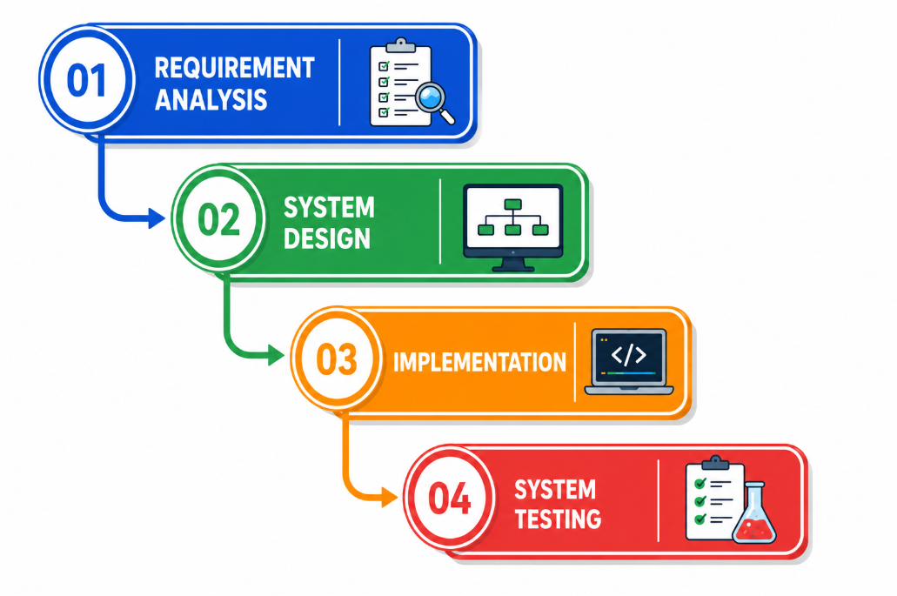
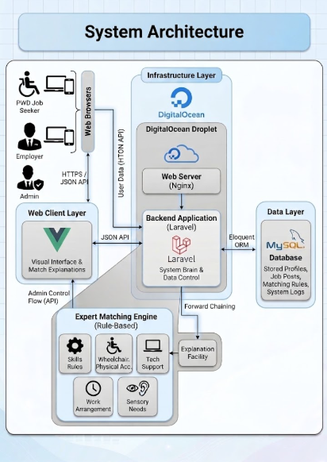
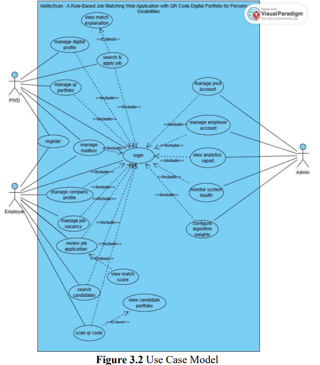
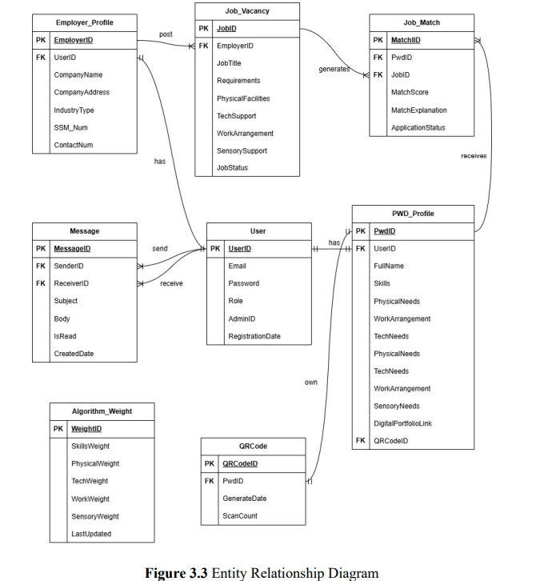
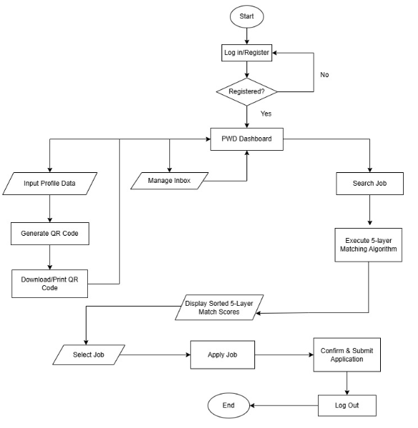
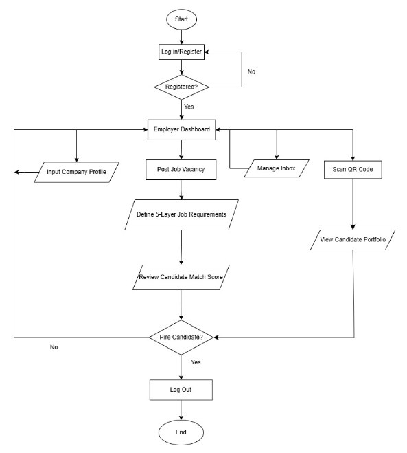
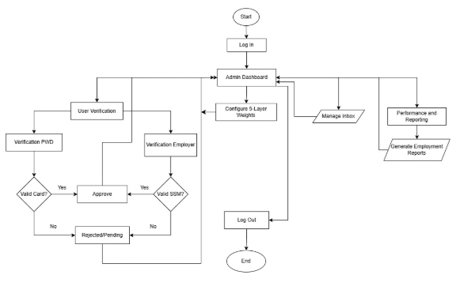

# AbilityScan
**A Rule-Based Job Matching Web Application with QR Code Digital Portfolios for Persons with Disabilities**

## Project Overview
AbilityScan is a Web Application recruitment platform designed to support inclusive employment opportunities for Persons with Disabilities (PWDs) in Malaysia. The system integrates a 5-Layer Rule-Based Matching Engine with QR Code Digital Portfolios to match candidates with suitable job opportunities based on their skills, accessibility requirements and working preferences. By providing explainable matching results, AbilityScan aims to improve transparency and help candidates better understand how their profiles align with job requirements.

## Key Features
* **Dynamic QR Code Portfolios:** Allows PWD candidates to generate accessible digital profiles for instant in-person scanning at career fairs.
* **5-Layer Rule-Based Matching Engine:** Filters job matches based on Skills, Physical Accessibility, Technology Support, Work Arrangements, and Sensory needs.
* **Explanation Facility:** Provides clear, human-readable explanations for every job match to eliminate algorithmic bias and build trust.
* **Role-Based Dashboards:** Secure, distinct interfaces for System Admins, Inclusive Employers, and PWD Candidates.

## 5-Layer Rule-Based Matching Engine

AbilityScan uses a rule-based matching approach to evaluate job compatibility between Persons with Disabilities (PWDs) and available job opportunities.

The matching process considers five key dimensions:

| Layer | Matching Criteria | Description |
|---|---|---|
| 1 | Skills | Compares candidate skills with job requirements. |
| 2 | Physical Accessibility | Considers physical accessibility needs and workplace requirements. |
| 3 | Technology Support | Evaluates compatibility between assistive technology needs and workplace support. |
| 4 | Work Arrangements | Considers working arrangements and candidate preferences. |
| 5 | Sensory Needs | Evaluates sensory-related requirements and workplace conditions. |

The system generates job compatibility results based on predefined rules and provides explanations to help candidates understand how their profiles align with job requirements.

## Technology Stack

| Component | Technology |
|---|---|
| Frontend | Vue.js, JavaScript, HTML, CSS |
| Backend | Laravel 11, PHP 8.3 |
| Database | MySQL |
| Web Server | Nginx |
| Operating System | Ubuntu 24.04 |
| Cloud Hosting | DigitalOcean |
| Version Control | Git & GitHub |
  

## Development Methodology

AbilityScan was developed using the Waterfall Model, following a structured software development process that includes requirements analysis, system design, implementation, testing, and deployment.

### Waterfall Model

## System Architecture & Design

The following diagrams illustrate the system architecture, user interactions, database relationships, and workflows of AbilityScan.

### System Architecture

Illustrates the overall architecture of AbilityScan and how its components interact.

### Use Case Diagram

Illustrates the interactions between the three main user roles: PWD Candidates, Employers, and Administrators.

### Entity Relationship Diagram (ERD)

Illustrates the database entities and their relationships within AbilityScan.

### System Flowcharts

The following flowcharts illustrate the main processes for each user role.

#### PWD Candidate Flowchart

#### Employer Flowchart

#### Administrator Flowchart

## 📸 System Screenshots

The following screenshots demonstrate the
three main user roles in AbilityScan:

- **PWD:** Job compatibility analysis and matching results.
- **Employer:** Recruitment management interface.
- **Admin:** System administration interface.

## Deployment

AbilityScan was deployed on a DigitalOcean cloud server running Ubuntu 24.04.

The deployment environment included:

- **Cloud Platform:** DigitalOcean
- **Operating System:** Ubuntu 24.04
- **Web Server:** Nginx
- **Backend Runtime:** PHP 8.3
- **Database:** MySQL
- **Frontend Build Tool:** Vite

The deployment process involved configuring the web server, setting up the database, installing project dependencies, building frontend assets, and configuring the Laravel application for the server environment.

## My Contributions

As the developer of AbilityScan, my responsibilities included:

- Identifying the recruitment problem and analysing system requirements.
- Designing use case diagrams, flowcharts, Entity Relationship Diagrams (ERD), and user interface prototypes.
- Developing the web application using Laravel, Vue.js, and MySQL.
- Implementing the rule-based job matching engine and QR code digital portfolio features.
- Conducting system testing and troubleshooting.
- Preparing the Final Year Project report and technical documentation.
- Deploying the application on an Ubuntu server using Nginx.

## Acknowledgments
Developed as a Final Year Project for the Bachelor of Computer Science (Hons) Netcentric Computing program at Universiti Teknologi MARA (UiTM) Shah Alam. 
Special thanks to my supervisor for the continued guidance throughout the development lifecycle.

